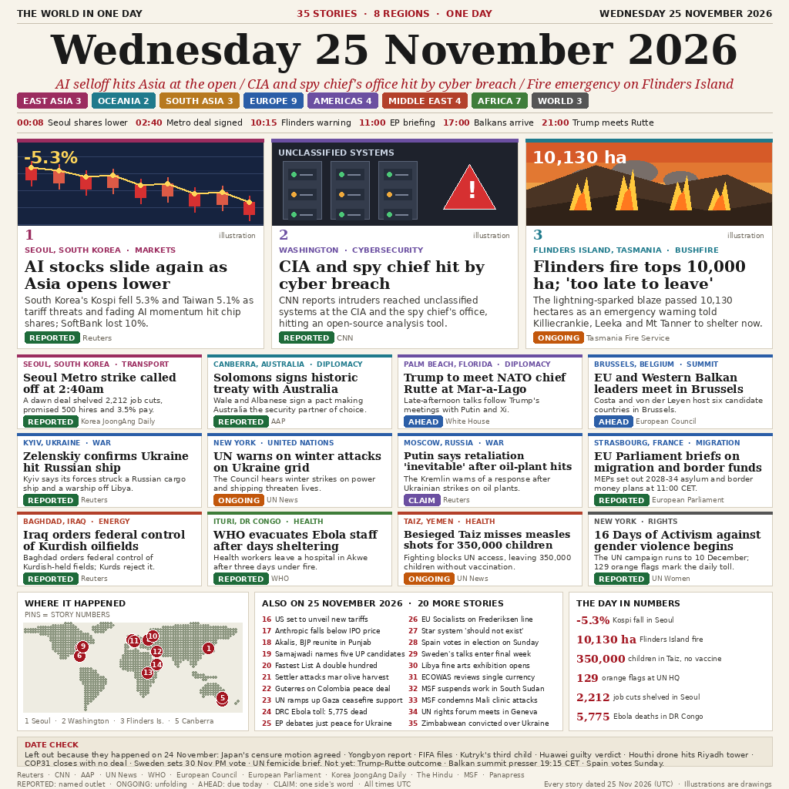

# The World in One Day — Wednesday 25 November 2026

[](https://make.fun/bounty/news-image-20261125?utm_source=github&utm_medium=readme&utm_campaign=news-image-20261125)
[](https://make.fun/bounty/news-image-20261125?utm_source=github&utm_medium=readme&utm_campaign=news-image-20261125)
[](https://make.fun/bounty/news-image-20261125?utm_source=github&utm_medium=readme&utm_campaign=news-image-20261125)

One image summing up the world's news of **Wednesday 25 November 2026**:
35 stories across 8 regions, drawn as a newspaper front page.



## The day

Three stories lead the page:

1. **AI stocks slide again as Asia opens lower** — South Korea's Kospi fell
   5.3% and Taiwan 5.1% as tariff threats and fading AI momentum hit chip
   shares; SoftBank lost 10%. *(Reuters)*
2. **CIA and spy chief hit by cyber breach** — intruders reached
   unclassified systems at the CIA and the Director of National
   Intelligence. *(CNN)*
3. **Flinders fire tops 10,000 ha; 'too late to leave'** — the
   lightning-sparked Tasmanian bushfire passed 10,130 hectares.
   *(Tasmania Fire Service)*

Below them: 12 more stories in cards, a 20-item "Also on" strip, a dotted
world map with numbered pins, a UTC timeline, the day in numbers, and a
**DATE CHECK** box that names the near-miss stories left out because they
happened on 24 November (Japan's censure motion, the Yongbyon report, the
FIFA files, Kutryk's third child, the Huawei verdict, the Riyadh tower
strike, COP31, Sweden's 30 November vote, the UN femicide brief).

## Certainty

Every card carries a tag so the reader can tell what is solid and what is
not: **REPORTED** (carried by a named outlet), **ONGOING** (still
unfolding), **AHEAD** (due later today), **CLAIM** (one side's word).

## How it is built

- `stories.json` — the 35 stories, each date-audited against wire
  timestamps for 25 November 2026, with region, source and certainty tag.
- `render.py` — draws `entry.png` (1024×1024) with Pillow from
  `stories.json`. Deterministic: fixed fonts, no randomness, no network.
- `main.py` — the competition entry point (Python 3.13, standard library
  only). It copies `entry.png` to the output directory and checks the PNG
  header and the 1 MiB size limit.

Run it:

```sh
python3 render.py
MAKEFUN_OUTPUT_DIR=out python3 main.py
```

## Licence

MIT — see [LICENSE](LICENSE).
